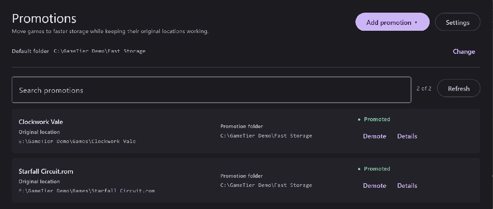
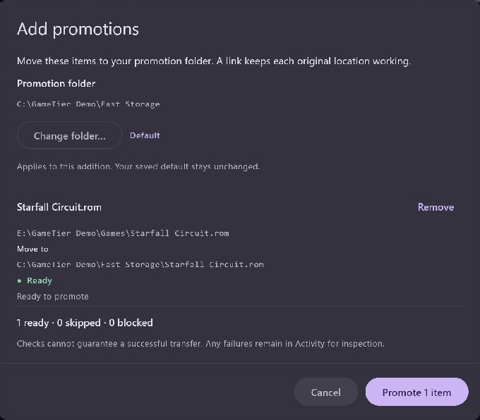

  

# GameTier  

Move games to faster storage while keeping their original locations working.
GameTier moves whole game folders or individual files, such as ROMs, and leaves
a symbolic link behind so your launcher or emulator can still find them.
Move them back whenever you need the space.

Promotion keeps a snapshot on the original drive, so it does not free space
there. The promoted files receive subsequent changes; the snapshot stays as it
was at promotion. Snapshots live in
`<source-drive>:\.gametier\backups\<original-name>`.

## Install

[Download the latest Windows installer](https://github.com/bkahlert/gametier/releases/latest),
open the `.msi`, then launch **GameTier** from the Start menu.
Requires Windows x64. Install a newer version to upgrade.
Current releases are unsigned, so Windows may show a publisher warning.

## Use

1. Close the game and any other programs writing to its files.
2. Drag files or folders into GameTier, or use **Add promotion** to choose them.
3. Choose a folder on your faster drive, review the selection, and click **Promote**.
   Your first destination becomes the default for future additions.

You can also right-click one file or folder and choose **Promote with GameTier**
(Windows 11: **Show more options**). Turn this option off in **Settings**.

Use **Demote** to return the latest game files to their original location. With a
source backup, the original drive needs temporary space for the returning files;
the backup and promoted copy are removed after a successful return.

If the promoted files become unavailable, **Restore backup** returns the snapshot.
Changes made after promotion will be missing. **Details** shows the backup location;
ordinary files and restore instructions also allow manual recovery without GameTier.
Older promotions without snapshots are marked **Unprotected** and can still be demoted.

Search finds promotions by name or path; **Activity** shows queued work and results.
Keep GameTier open until transfers finish.

If Windows blocks symbolic links, open **Activity → Allow symbolic links… →
Restart as administrator**. Approve the Windows prompt, then review and confirm
the pending moves. For other failures, inspect the details in Activity before retrying.

## Development

Built with Kotlin and Compose Multiplatform. See the [development guide](desktopApp/README.md)
to build, run, or test from source.

## License

[MIT](LICENSE)
